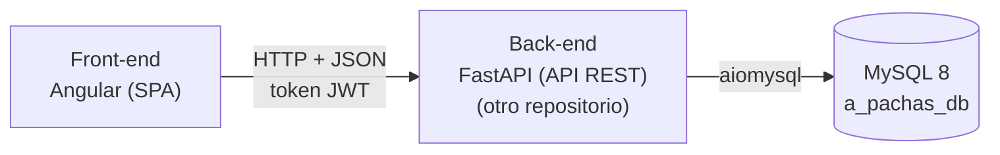

# A Pachas · Front-end

SPA de **A Pachas**, una aplicación web para dividir gastos compartidos: una cena de amigos, un regalo de cumpleaños, un viaje, los gastos de una casa compartida...

Cada usuario puede crear grupos de gastos e invitar a otros usuarios. La app registra quién ha pagado cada gasto, cómo se reparte entre los participantes y las deudas que se saldan, y calcula automáticamente cuánto debe o le deben a cada miembro.

> 🔗 **Este repositorio contiene el front-end** (SPA con Angular).
> La API REST (FastAPI) y la base de datos (MySQL 8) están en **[backend-proyecto-final](https://github.com/AaronPvon/backend-proyecto-final)**. El front-end necesita la API en marcha para funcionar.

> Los pagos reales (transferencias, Bizum, etc.) se hacen fuera de la aplicación. A Pachas solo los registra y hace las cuentas.

El proyecto se basa en el enunciado **"Compartir gastos"**.

## Estado del proyecto

| Bloque | Estado |
|---|---|
| Base y autenticación: navbar, footer, inicio, registro, login, guards e interceptor | ✅ Completado |
| Grupos: "Mis grupos" con filtro activos/cerrados, creación y detalle con saldos, presupuesto y miembros | ✅ Completado |
| Invitaciones | ⏳ Pendiente |
| Gastos: listado y creación | ⏳ Pendiente |
| Editar y borrar gastos, liquidaciones, cierre y reapertura, salir y expulsar | ⏳ Después de la entrega |
| Despliegue | ⏳ Pendiente |

El estado de la API está en su [repositorio](https://github.com/AaronPvon/backend-proyecto-final#estado-del-proyecto).

## Funcionalidades

### Requisitos mínimos del enunciado
- Registro e inicio de sesión de usuarios.
- Creación de grupos con título, descripción y presupuesto opcional.
- El creador del grupo invita al resto de usuarios.
- El creador registra los gastos y las liquidaciones, y la app calcula automáticamente lo que debe cada miembro.
- El resto de miembros solo visualizan los gastos, las deudas y los saldos del grupo.

### Funcionalidades previstas para más adelante
- Mensajería asíncrona entre los miembros de un grupo.
- Eliminación de cuenta.
- Simplificación de deudas (mínimo número de transferencias para dejar todos los saldos a cero).
- Recuperación de contraseña y página de perfil.
- Instalación en el móvil como PWA.

## Cómo funciona

- **Grupos y miembros.** Cualquier usuario puede crear todos los grupos que necesite. El creador es el único que los gestiona: invita a usuarios por email o nickname, registra gastos y liquidaciones, expulsa miembros y cierra o reabre el grupo. Los invitados deben aceptar la invitación y, a partir de ahí, ven toda la información del grupo, pero no la modifican.
- **Gastos y repartos.** Cada gasto indica quién lo pagó y cómo se reparte: a partes iguales entre todos, a partes iguales entre algunos o con importes personalizados.
- **Saldos.** `saldo = lo pagado − lo que le corresponde + liquidaciones enviadas − liquidaciones recibidas`. Positivo: le deben dinero. Negativo: debe dinero.
- **Ciclo de vida.** Los grupos nunca se borran: se cierran y quedan en solo lectura. Un miembro solo puede salir (o ser expulsado) con saldo 0.

Las reglas completas están en el [README de la API](https://github.com/AaronPvon/backend-proyecto-final#cómo-funciona).

## Tecnologías

| Ámbito | Tecnología |
|---|---|
| Framework | Angular 22.2 (sin zone.js) |
| Lenguaje | TypeScript |
| Estilos | Tailwind CSS 4 con tokens propios y clases de CSS propio |
| Formularios | Formularios reactivos (`ReactiveFormsModule`), con las mismas validaciones que la API |
| Comunicación con la API | `HttpClient` + interceptor con el token JWT |



## Requisitos

- [Node.js](https://nodejs.org/) `^22.22.3`, `^24.15.0` o `>=26`, con npm.
- La API de [backend-proyecto-final](https://github.com/AaronPvon/backend-proyecto-final) arrancada en `http://localhost:8000`, con la base de datos creada y `http://localhost:4200` en su variable `CORS_ORIGINS`.

No hace falta instalar Angular CLI de forma global: los scripts de npm usan la versión local del proyecto.

## Puesta en marcha

### 1. Arrancar la API

Sigue los pasos del [README de la API](https://github.com/AaronPvon/backend-proyecto-final#puesta-en-marcha): crear la base de datos, configurar el `.env` y arrancar con `uvicorn main:app --reload`.

### 2. Clonar el repositorio e instalar las dependencias

```bash
git clone https://github.com/AaronPvon/frontend-proyecto-final.git
cd frontend-proyecto-final
npm install
```

### 3. Revisar la URL de la API

La URL de la API se define en `src/environments/environment.ts`:

```typescript
export const environment = {
  apiUrl: 'http://localhost:8000/api',
};
```

Con la API en local no hay que cambiar nada. Si la API está en otra dirección (por ejemplo, al desplegarla), basta con cambiar `apiUrl`.

### 4. Arrancar el servidor de desarrollo

```bash
npm start
```

La app queda disponible en `http://localhost:4200` y se recarga sola al guardar cambios.

Para probarla, inicia sesión con cualquiera de los [usuarios de prueba](https://github.com/AaronPvon/backend-proyecto-final#datos-de-prueba), por ejemplo `anag` con la contraseña `Pachas123!`.

### 5. Compilar para producción

```bash
npm run build
```

Genera la versión optimizada en la carpeta `dist/`.

### Scripts disponibles

| Script | Qué hace |
|---|---|
| `npm start` | Arranca el servidor de desarrollo (`ng serve`) en `http://localhost:4200`. |
| `npm run build` | Compila la app para producción en `dist/`. |
| `npm run watch` | Compila en modo desarrollo y vuelve a compilar al guardar cambios. |

## Rutas de la aplicación

La app muestra siempre un navbar, el contenido y un footer. El navbar enlaza a Inicio, Login y Register sin sesión, y a Inicio, Mis grupos, Invitaciones y Cerrar sesión con sesión iniciada.

| Ruta | Acceso | Contenido |
|---|---|---|
| `/` | Pública | Página de inicio: "¡Bienvenido!" o, con sesión, "¡Bienvenido, {nombre}!". |
| `/login` | Pública (sin sesión) | Inicio de sesión con email o nickname y contraseña. Con `?registered=1` muestra "Cuenta creada". |
| `/register` | Pública (sin sesión) | Registro: nombre, apellidos, nickname, email, contraseña y repetir contraseña. Después redirige a `/login?registered=1`. |
| `/groups` | Privada | "Mis grupos", con filtro de activos (por defecto) y cerrados (`/groups?status=closed`). |
| `/groups/new` | Privada | Creación de un grupo: título, descripción, presupuesto (opcional) y moneda. Después redirige al detalle. |
| `/groups/:id` | Privada (miembros) | Detalle del grupo: saldos, presupuesto y miembros. Un grupo ajeno o inexistente muestra "Grupo no encontrado". |
| `/invitations` | Privada | Invitaciones pendientes, para aceptarlas o rechazarlas. |

## Autenticación

- El token se guarda en `localStorage` (clave `a_pachas_token`). Al arrancar, la app recupera el usuario con `GET /api/users/me`.
- Tras el login se redirige a `/groups`.
- Un interceptor añade la cabecera `Authorization: Bearer <token>`, solo a las peticiones dirigidas a la API.
- Si la API responde 401 (token caducado o no válido), se cierra la sesión y se redirige a `/login`. La excepción es el propio login, donde un 401 significa "Credenciales incorrectas".
- `authGuard` protege las rutas privadas y `guestGuard` redirige a `/groups` a quien ya ha iniciado sesión y entra en `/login` o `/register`.
- Los permisos reales los comprueba siempre la API; el front-end solo oculta lo que el usuario no puede hacer.

## Estructura del proyecto

```
frontend-proyecto-final/
├── README.md
├── AGENTS.md                  # documento de referencia del front-end
├── docs/
│   └── Compartir_gastos.pdf   # enunciado del proyecto
├── angular.json
├── package.json
├── public/
│   └── logo.svg               # logotipo y favicon
└── src/
    ├── environments/
    │   └── environment.ts     # URL de la API
    ├── styles.css             # tokens de Tailwind y clases propias
    └── app/
        ├── core/
        │   ├── components/    # navbar, footer, logo...
        │   ├── guards/        # authGuard y guestGuard
        │   ├── interceptors/  # token y gestión del 401
        │   ├── interfaces/    # tipos de los datos de la API
        │   └── utils/         # mensajes de error y utilidades
        └── features/          # una carpeta por funcionalidad
            ├── home/
            ├── users/
            └── groups/        # cada una con pages/ y services/
```

## Diseño

- Estética oscura y futurista: fondo azul noche con resplandores azules y una rejilla suave, contenido en paneles de cristal (`.panel`, con `backdrop-blur`) y títulos con degradado (`.text-gradient`).
- Colores principales, definidos en `styles.css`: `light-blue` #19b0d4, `dark-blue` #1e293b y `orange` #f5684a, con colores de apoyo (`night`, `deep-blue`, `frost`, `muted`) y de significado (`owed` verde para lo que te deben y `owes` rojo para lo que debes).
- Los botones naranjas llevan el texto en `dark-blue`, porque el blanco no cumple el contraste mínimo.
- Tipografías: Sora (títulos) y Public Sans (texto).
- Logotipo: una moneda en degradado azul cortada por una línea naranja.

## Convenciones

- Idioma `es-ES` para los pipes `currency` y `date`: los importes se muestran como "176,66 €".
- La API envía los importes como texto (`"176.66"`) para que sean exactos; el front-end los convierte a número solo para mostrarlos.
- El presupuesto admite coma o punto en el formulario y se envía a la API con punto (`"150.50"`).
- Los parámetros de ruta llegan a los componentes como `input()` (`withComponentInputBinding`).

## Despliegue

Durante el desarrollo, la app se ejecuta en local con `npm start`. Más adelante se desplegará en un cloud de prácticas, aún por concretar; para ello bastará con apuntar `apiUrl` a la API desplegada.

## Documentación

- [`AGENTS.md`](AGENTS.md): reglas de negocio, permisos, contrato con la API y decisiones tomadas en el front-end.
- [`docs/Compartir_gastos.pdf`](docs/Compartir_gastos.pdf): enunciado del proyecto.
- API, base de datos y endpoints: [backend-proyecto-final](https://github.com/AaronPvon/backend-proyecto-final).

## Autoría

| | |
|---|---|
| **Autor** | Aarón Pavón Pavón |
| **Curso** | Máster en Desarrollo Web FullStack (febrero - noviembre de 2026) |
